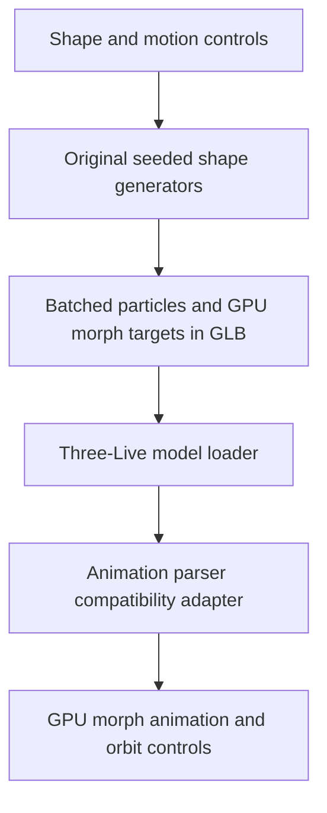

# Dense portfolio particles in Three-Live

## Current dense version

The page now uses `shapes.js` (the original shape generators) and `particle-model.js` to generate a standard GLB for `loadModel()`. It renders 4,200 particles on phones or 6,000 on desktop. Batched primitives stay below the morph texture width limit. Three GPU morph targets provide shape interpolation, gentle drift and an outward burst; keyframe animation also adds slight rotation. Shape selection frames the camera around a fixed target.

The CDN loader initializes its animation array to an empty array, preventing its keyframes plugin from parsing the weight tracks. A confined workaround in `pilot.js` uses the bundle's exported `parseAnimations` helper and assigns the clips to the runtime before calling `play()`. This runtime-state workaround should be removed when the upstream loader is fixed.

Reduced motion starts with transitions disabled. The idle animation wraps after 120 seconds. Soft GLSL sprites, cursor repulsion and page scroll coupling remain absent. The earlier sandbox script has been removed; its source remains in git history.

The original portfolio entry page is separate from this noindex experiment. No application API or authentication is involved.

Vendor: Google Three-Live, Apache-2.0, downloaded 2026-11-06 from https://google.github.io/three-live/dist/three-live-full.min.js, saved as `vendor/three-live.min.js`. License is beside the bundle. Upstream source inspected at commit `3c554bf8c26da37b1f8b6ed8ebb982f8bde7a5f0`; the CDN artifact may have a different build revision.
